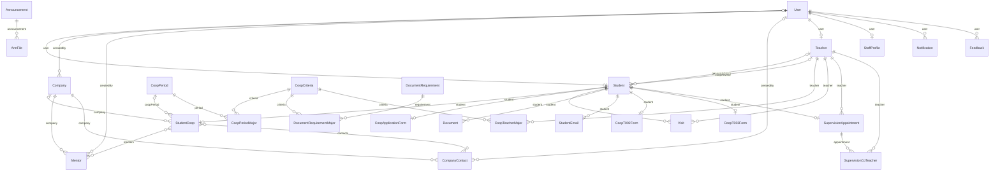

# แผนภาพฐานข้อมูล (ER Diagram)

> สร้างอัตโนมัติจาก `backend/prisma/schema.prisma` ด้วย `node backend/scripts/er_diagram.js` — อย่าแก้ไฟล์นี้ด้วยมือ
> 30 ตาราง · 7 enum

สัญลักษณ์เส้น (crow's foot): `||` = หนึ่งเสมอ · `|o` = ศูนย์หรือหนึ่ง · `o{` = ศูนย์หรือหลาย · `}o--o{` = หลายต่อหลาย
ป้ายบนเส้น = ชื่อฟิลด์ความสัมพันธ์ฝั่งตารางที่ถือ foreign key · PK = primary key · FK = foreign key · UK = unique

## ภาพรวมความสัมพันธ์

## รายละเอียดคอลัมน์

```mermaid
erDiagram
  User {
    Int id PK
    String username UK
    String password
    String passwordEnc
    String email
    enum_Role role
    Int tokenVersion
    String provider
    String kkuAccessToken
    DateTime createdAt
    DateTime updatedAt
  }
  SystemConfig {
    Int id PK
    String key UK
    String value
    DateTime updatedAt
  }
  Student {
    Int id PK
    String studentId UK
    enum_Prefix prefix
    String firstName
    String lastName
    String firstNameEn
    String lastNameEn
    String major
    String year
    String phone
    String email
    enum_StudyProgram studyProgram
    Float gpa
    Int activityUnit
    DateTime apiSyncedAt
    String advisorName
    String jobPosition
    DateTime deletedAt
    Int generalAdvisorId FK
    Int coopAdvisorId FK
    Int userId FK,UK
    DateTime createdAt
    DateTime updatedAt
  }
  StudentCoop {
    Int id PK
    Int studentId FK,UK
    enum_CoopStatus status
    String teacherCheckComment
    DateTime teacherCheckDate
    String companyId FK
    String jobPosition
    enum_DocStatus t000Status
    String t000Comment
    String staffCheckComment
    String reqDocNumber
    String reqLetterBatch
    DateTime reqDocDate
    String reqLetterUrl
    DateTime reqLetterPendingAt
    String reqLetterDraftNumber
    DateTime reqLetterDraftDate
    String reqLetterDelivery
    String acceptanceFileUrl
    DateTime actualStartDate
    DateTime actualEndDate
    String placeDocNumber
    String placeLetterBatch
    DateTime placeDocDate
    String placeLetterUrl
    DateTime placeLetterPendingAt
    String placeLetterDraftNumber
    DateTime placeLetterDraftDate
    String placeLetterDelivery
    Json deadlineExtensions
    Json submittedSteps
    DateTime createdAt
    DateTime updatedAt
    Int coopPeriodId FK
  }
  CoopPeriod {
    Int id PK
    String academicYear
    Int semester
    DateTime startDate
    DateTime endDate
    Json deadlines
    DateTime createdAt
    DateTime updatedAt
  }
  CoopApplicationForm {
    Int id PK
    Int studentId FK,UK
    String contactAddress
    String contactAddrNo
    String contactMoo
    String contactSoi
    String contactRoad
    String contactSubDistrict
    String contactDistrict
    String contactProvince
    String contactZipcode
    String contactPhone
    String contactEmail
    String emergencyName
    String emergencyRelation
    String emergencyJob
    String emergencyWorkplace
    String emergencyAddress
    String emerAddrNo
    String emerMoo
    String emerSoi
    String emerRoad
    String emerSubDistrict
    String emerDistrict
    String emerProvince
    String emerZipcode
    String emergencyPhone
    String emergencyEmail
    DateTime startDate
    DateTime endDate
    String careerObjective1
    String careerObjective2
    String careerObjective3
    String gradeSheetUrl
    String photoPath
    DateTime updatedAt
  }
  CoopCriteria {
    String id PK
    String major UK
    String nameTh
    DateTime updatedAt
  }
  CoopPeriodMajor {
    Int periodId PK,FK
    String major PK,FK
    DateTime startDate
    DateTime endDate
    Boolean isActive
    DateTime supervisionStartDate
    DateTime supervisionEndDate
    Boolean isSupervisionOpen
    Json deadlines
    DateTime updatedAt
  }
  DocumentRequirementMajor {
    Int requirementId PK,FK
    String major PK,FK
    Boolean excluded
  }
  CoopTeacherMajor {
    Int teacherId PK,FK
    String major PK,FK
  }
  Company {
    String id PK
    String name
    String nameEn
    String address
    String addressNo
    String moo
    String soi
    String road
    String subDistrict
    String district
    String province
    String zipcode
    String fax
    String phone
    String email
    String website
    String pastYears
    String contactPerson
    String contactPosition
    Int createdById FK
    DateTime createdAt
    DateTime updatedAt
  }
  Mentor {
    String id PK
    String firstName
    String lastName
    String department
    String position
    String email
    String phone
    String companyId FK
    Int createdById FK
    DateTime createdAt
    DateTime updatedAt
  }
  CompanyContact {
    String id PK
    String firstName
    String lastName
    String position
    String department
    String email
    String phone
    String companyId FK
    Int createdById FK
    DateTime createdAt
    DateTime updatedAt
  }
  Teacher {
    Int id PK
    String prefix
    String firstName
    String lastName
    String email UK
    String phone
    String faculty
    String major
    Boolean isCoopTeacher
    Int userId FK,UK
    DateTime createdAt
    DateTime updatedAt
  }
  StaffProfile {
    Int id PK
    Int userId FK,UK
    String firstName
    String lastName
    String phone
    DateTime createdAt
    DateTime updatedAt
  }
  Visit {
    Int id PK
    DateTime date
    String time
    String location
    String note
    String status
    Int studentId FK
    Int teacherId FK
    DateTime createdAt
  }
  Document {
    Int id PK
    Int studentId FK
    String name
    String path
    String rejectReason
    String type
    enum_DocStatus status
    DateTime uploadedAt
  }
  DocumentRequirement {
    Int id PK
    String docKey UK
    String title
    String description
    Boolean isRequired
    Boolean isActive
    DateTime createdAt
    DateTime updatedAt
  }
  StudentEmail {
    Int id PK
    String email
    Boolean primary
    Int studentId FK
  }
  Announcement {
    String id PK
    String title
    String body
    DateTime date
    String year
    String linkUrl
    Json targetMajors
    Boolean pinned
    Int authorId
    DateTime publishAt
    DateTime notifiedAt
    DateTime createdAt
    DateTime updatedAt
  }
  AnnFile {
    String id PK
    String announcementId FK
    String name
    String mime
    String path
  }
  SystemAsset {
    String key PK
    String label
    String path
    String mimeType
    DateTime updatedAt
  }
  CoopT002Form {
    Int id PK
    Int studentId FK,UK
    String companyNameTh
    String companyNameEn
    String addressNo
    String moo
    String soi
    String road
    String subDistrict
    String district
    String province
    String zipcode
    String companyPhone
    String companyFax
    String companyEmail
    String managerName
    String managerPosition
    String managerPhone
    String managerFax
    String managerEmail
    String coordinatorType
    String coordName
    String coordPosition
    String coordDept
    String coordPhone
    String coordFax
    String coordEmail
    String supervisorName
    String supervisorPosition
    String supervisorDept
    String supervisorPhone
    String supervisorFax
    String supervisorEmail
    String extraSupervisors
    String jobPosition
    String jobDescription
    String accommodationAddress
    String accomAddrNo
    String accomMoo
    String accomSoi
    String accomRoad
    String accomSubDistrict
    String accomDistrict
    String accomProvince
    String accomZipcode
    String accommodationPhone
    String emergencyName
    String emergencyAddress
    String emerAddrNo
    String emerMoo
    String emerSoi
    String emerRoad
    String emerSubDistrict
    String emerDistrict
    String emerProvince
    String emerZipcode
    String emergencyPhone
    String emergencyFax
    String emergencyEmail
    DateTime createdAt
    DateTime updatedAt
  }
  CoopT003Form {
    Int id PK
    Int studentId FK,UK
    String reportTitleTh
    String reportTitleEn
    String objectives
    String expectedOutcomes
    String significance
    String references
    String methodology
    String scope
    String otherSuggestions
    Json workPlan
    DateTime createdAt
    DateTime updatedAt
  }
  SupervisionAppointment {
    Int id PK
    Int studentId FK,UK
    Int teacherId FK
    String coTeacherName
    String proposedDates
    enum_SupervisionType supervisionType
    DateTime confirmedDate
    DateTime confirmedEndDate
    String rejectReason
    enum_SupervisionStatus status
    String officialLetterPath
    String letterDocNumber
    DateTime letterDocDate
    DateTime letterPendingAt
    String letterDraftNumber
    DateTime letterDraftDate
    String onlineLink
    String groupId
    DateTime evalSentAt
    DateTime createdAt
    DateTime updatedAt
  }
  SupervisionCoTeacher {
    Int appointmentId PK,FK
    Int teacherId PK,FK
    String availableDates
    DateTime respondedAt
  }
  Notification {
    Int id PK
    Int userId FK
    String type
    String title
    String message
    String link
    Boolean isRead
    String relatedId
    DateTime createdAt
  }
  AuditLog {
    Int id PK
    DateTime createdAt
    Int userId
    String role
    String actorName
    String action
    String method
    String path
    String targetType
    String targetId
    String targetName
    Int statusCode
    String ip
    String detail
  }
  Feedback {
    Int id PK
    Int userId FK
    String role
    String kind
    String message
    String pagePath
    String contextNote
    String userAgent
    String imagePath
    String status
    String staffReply
    Int handledById
    String handledName
    DateTime handledAt
    DateTime createdAt
    DateTime updatedAt
  }
  DocNumberLock {
    String kind PK
    String number PK
    DateTime createdAt
  }
  Teacher |o--o{ Student : "generalAdvisor"
  Teacher |o--o{ Student : "coopAdvisor"
  User ||--o| Student : "user"
  Student ||--o| StudentCoop : "student"
  Company |o--o{ StudentCoop : "company"
  StudentCoop }o--o{ Mentor : "mentors"
  StudentCoop }o--o{ CompanyContact : "contacts"
  CoopPeriod |o--o{ StudentCoop : "coopPeriod"
  Student ||--o| CoopApplicationForm : "student"
  CoopPeriod ||--o{ CoopPeriodMajor : "period"
  CoopCriteria ||--o{ CoopPeriodMajor : "criteria"
  DocumentRequirement ||--o{ DocumentRequirementMajor : "requirement"
  CoopCriteria ||--o{ DocumentRequirementMajor : "criteria"
  Teacher ||--o{ CoopTeacherMajor : "teacher"
  CoopCriteria ||--o{ CoopTeacherMajor : "criteria"
  User |o--o{ Company : "createdBy"
  Company ||--o{ Mentor : "company"
  User |o--o{ Mentor : "createdBy"
  Company ||--o{ CompanyContact : "company"
  User |o--o{ CompanyContact : "createdBy"
  User ||--o| Teacher : "user"
  User ||--o| StaffProfile : "user"
  Student ||--o{ Visit : "student"
  Teacher ||--o{ Visit : "teacher"
  Student ||--o{ Document : "student"
  Student ||--o{ StudentEmail : "student"
  Announcement ||--o{ AnnFile : "announcement"
  Student ||--o| CoopT002Form : "student"
  Student ||--o| CoopT003Form : "student"
  Student ||--o| SupervisionAppointment : "student"
  Teacher ||--o{ SupervisionAppointment : "teacher"
  SupervisionAppointment ||--o{ SupervisionCoTeacher : "appointment"
  Teacher ||--o{ SupervisionCoTeacher : "teacher"
  User ||--o{ Notification : "user"
  User ||--o{ Feedback : "user"
```

